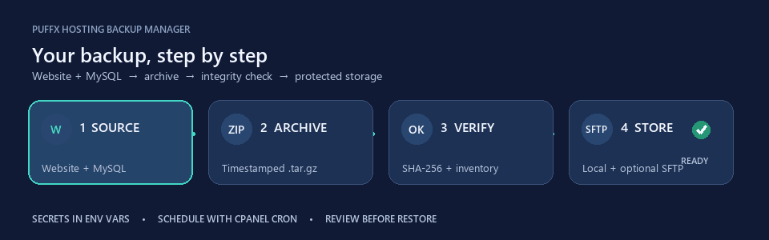

# 🌤️ Puffx Hosting Backup Manager

**cPanel website aur MySQL database ke backups—step by step.** Yeh Python command-line tool website folders copy karta hai, `mysqldump` se database export leta hai, dono ko compressed archive mein rakhta hai, SHA-256 se archive verify karta hai aur purane local backups par retention apply karta hai. Optional SFTP se remote copy bhi bhej sakta hai.



> 🎞️ Upar animated GIF backup ka flow dikhata hai. Scalable vector version [assets/backup-workflow.svg](assets/backup-workflow.svg) mein bhi hai; kuch viewers SVG animation ko static dikha sakte hain.

## 🧭 Is guide mein kya milega

1. cPanel par requirements check karna
2. Project download aur Python setup
3. Backup folder, website paths aur database config karna
4. Password secure rakhna
5. Pehla backup banana aur verify karna
6. cPanel Cron Job schedule karna
7. Website files ya database restore karna
8. Optional SFTP off-site copy lagana
9. Common errors ko solve karna

---

## ✅ Pehle yeh cheezein ready karein

- cPanel login aur **Terminal/SSH** access
- cPanel mein **Cron Jobs** feature
- Python **3.12 ya naya**
- `mysqldump` aur `mysql` command line tools
- Website directory read karne ki permission
- MySQL database ka exact naam, username, password aur host
- Backup ke liye home folder mein khaali disk space

### Step 0: cPanel Terminal mein requirements check karein

cPanel kholen → **Terminal**, phir yeh commands ek-ek karke chalayein:

```sh
python3.12 --version
mysqldump --version
mysql --version
```

**Expected:** Python version `3.12` ya zyada ho aur MySQL tools apna version dikhayein. Agar koi command `command not found` kahe, hosting provider se use enable karwayein. Tool ko Python 3.11 ya usse purane version par chalane ki koshish na karein.

### 🔐 Backup data ko public website se door rakhein

`public_html` web se accessible ho sakta hai. Backup archive mein database, user records, sessions aur site files ho sakte hain. Isliye config, password file, archives aur logs ko `/home/CPANEL_USER/` ke neeche rakhein—`public_html` ke andar nahin.

---

# 🚀 Setup: poora step-by-step

## Step 1 — Apna cPanel username aur home path note karein

Terminal mein:

```sh
whoami
pwd
```

`whoami` username dikhata hai. `pwd` ka output aksar `/home/CPANEL_USER` jaisa hota hai. Is guide mein jahan `CPANEL_USER` likha hai, wahan apna actual cPanel username likhein. **Commands mein placeholder ko jaisa ka taisa na chhodein.**

## Step 2 — Project ko home directory mein download karein

Terminal mein:

```sh
cd ~
git clone https://github.com/puffxhost/puffx-hosting-backup-manager.git backup-manager
cd ~/backup-manager
pwd
ls
```

**Expected:** `pwd` ka path `/home/CPANEL_USER/backup-manager` ho; `ls` mein `backup_manager.py`, `config.example.toml` aur `pyproject.toml` dikhne chahiye.

### Agar `git` available nahin hai

1. Browser mein [GitHub repository](https://github.com/puffxhost/puffx-hosting-backup-manager) kholein.
2. **Code → Download ZIP** par click karein.
3. cPanel **File Manager** se ZIP ko home folder mein upload karke extract karein. `public_html` ke andar extract na karein.
4. Terminal mein extracted project folder par jaayein. Misal ke liye folder ka naam `puffx-hosting-backup-manager` ho to:

```sh
cd ~/puffx-hosting-backup-manager
```

Aage ke steps mein `~/backup-manager` likha hai. ZIP method mein har jagah ise apne extracted folder ke path se replace karein.

## Step 3 — Virtual environment banayein

Virtual environment project ke Python packages ko alag rakhta hai:

```sh
cd ~/backup-manager
python3.12 -m venv .venv
source .venv/bin/activate
python --version
```

**Expected:** prompt ke start mein `(.venv)` aur Python version `3.12` ya usse naya.

Agar `venv` module missing ho ya permission error aaye, hosting provider se Python virtual environment enable karwayein. System-wide `sudo pip` ki zaroorat nahin honi chahiye.

## Step 4 — Tool install karein

Virtual environment active rehne par:

```sh
python -m pip install --upgrade pip
python -m pip install .
```

**Expected:** install command errors ke bina complete ho. Is project mein core features ke liye third-party Python dependency nahin hai. Optional SFTP ke liye normal install ki jagah yeh command use karein:

```sh
python -m pip install '.[sftp]'
```

> Nayi Terminal session kholne par virtual environment phir activate karein: `cd ~/backup-manager && source .venv/bin/activate`.

## Step 5 — Backup directory banayein

Apne username ka placeholder replace karein:

```sh
mkdir -p /home/CPANEL_USER/backups
chmod 700 /home/CPANEL_USER/backups
```

Yeh directory `public_html` se bahar hai aur sirf account owner ke liye accessible banayi gayi hai.

## Step 6 — Example config copy karein

```sh
cd ~/backup-manager
cp config.example.toml config.toml
nano config.toml
```

`nano` mein save: **Ctrl+O**, phir **Enter**. Exit: **Ctrl+X**. Is config ko GitHub par commit/share na karein; `.gitignore` mein `config.toml` pehle se excluded hai.

## Step 7 — Website aur backup location set karein

`config.toml` ke `[backup]` section ko apne paths ke saath set karein:

```toml
[backup]
directory = "/home/CPANEL_USER/backups"
retention_count = 14
paths = ["/home/CPANEL_USER/public_html"]
```

- `directory`: Step 5 mein banaya folder.
- `retention_count`: safal backup ke baad kitne recent **local** archives rakhne hain. Kam-se-kam `1` hona chahiye.
- `paths`: ek ya zyada maujood website directories ke poore paths. Multiple folders ke liye TOML list mein comma laga kar aur entries jodein:

```toml
paths = ["/home/CPANEL_USER/public_html", "/home/CPANEL_USER/store"]
```

Har path pehle se directory hona chahiye. Program source folders ko `files/site-1`, `files/site-2` naam se archive karta hai; asli folder names archive mein preserve nahin hote. Relative paths se bachein; absolute paths use karein.

## Step 8 — Database details set karein

cPanel → **MySQL Databases** kholein. Apni site ka database aur usse assigned user note karein. `[database]` section update karein:

```toml
[database]
host = "localhost"
port = 3306
name = "CPANEL_USER_database"
user = "CPANEL_USER_dbuser"
password_env = "PUFFX_BACKUP_DB_PASSWORD"
```

- `name` aur `user` mein cPanel par dikhne wale poore naam daalein—aksar naam ke aage cPanel username prefix hota hai.
- `host` aur `port` hosting company ke mutabiq set karein. `localhost:3306` sirf common example hai.
- Database user ko database par zaroori read/dump access milna chahiye. Restore ke liye us user ko write privileges bhi chahiye.
- Password **TOML mein mat likhein**. Agle step mein use private environment file mein rakhenge.

## Step 9 — Database password ko private environment file mein rakhein

```sh
mkdir -p ~/.config/puffx-backup
chmod 700 ~/.config/puffx-backup
nano ~/.config/puffx-backup/env.sh
```

File mein yeh ek line likhein aur placeholder ko actual database password se replace karein:

```sh
export PUFFX_BACKUP_DB_PASSWORD='APNA_DATABASE_PASSWORD'
```

Save/exit (**Ctrl+O**, **Enter**, **Ctrl+X**), phir:

```sh
chmod 600 ~/.config/puffx-backup/env.sh
source ~/.config/puffx-backup/env.sh
```

Config ka `password_env` aur `env.sh` ka `export` variable naam **letter-for-letter same** hona chahiye. Agar TOML mein naam badla, yahan bhi badlein. Password ko terminal command ke argument mein type karna avoid karein. Password mein single quote ho to yeh shell example seedha kaam nahin karega; hosting provider se protected environment variable set karne ka tareeqa lein.

**File check:** `cat ~/.config/puffx-backup/env.sh` secret screen par dikhata hai, isliye use shared screen/log mein na chalayein. Sirf `ls -l ~/.config/puffx-backup/env.sh` se permissions verify karein; mode `-rw-------` hona chahiye.

## Step 10 — Config aur folders validate karein

```sh
cd ~/backup-manager
source .venv/bin/activate
source ~/.config/puffx-backup/env.sh
ls -ld /home/CPANEL_USER/backups /home/CPANEL_USER/public_html
```

Dono paths ka exist karna zaroori hai. `config.toml` ko dobara khol kar username, folder path, DB name/user aur `password_env` check karein. Tool config load karte waqt website paths aur password environment variable check karta hai.

## Step 11 — Pehla backup manually banayein

Cron schedule karne se pehle manual run karein:

```sh
cd ~/backup-manager
source ~/.config/puffx-backup/env.sh
.venv/bin/python backup_manager.py --config config.toml backup
```

**Successful output:**

```text
Created verified backup: /home/CPANEL_USER/backups/backup-YYYYMMDDTHHMMSSZ.tar.gz
```

Real timestamp alag hoga. Is run mein tool website folders stage karta hai, `mysqldump` se SQL banata hai, `.tar.gz` archive likhta hai, `.json` manifest/SHA-256 banata hai, verify karta hai, optional SFTP upload karta hai, phir verified purane local backups par retention lagata hai.

Agar pehla run fail ho, Cron Job abhi na banayein—**Troubleshooting** section mein error solve karein.

## Step 12 — Archive verify karein

```sh
cd ~/backup-manager
.venv/bin/python backup_manager.py verify --backup-dir /home/CPANEL_USER/backups
```

**Expected:** har archive ke saamne `OK /home/.../backup-....tar.gz`. Verify command ko matching `.tar.gz.json` manifest bhi chahiye. Yeh archive ka naam, SHA-256 digest aur uske andar file inventory check karta hai. Koi archive na ho to `No backup archives found` aayega.

Ek archive verify karna ho to:

```sh
.venv/bin/python backup_manager.py verify --archive /home/CPANEL_USER/backups/backup-YYYYMMDDTHHMMSSZ.tar.gz
```

## Step 13 — cPanel Cron Job schedule karein

Cron har din backup command apne aap chalata hai. Password ko Cron UI mein seedha paste nahin karna; command protected `env.sh` load karti hai.

1. cPanel → **Cron Jobs** kholein.
2. Common Settings se **Once Per Day** select karein (ya apna desired schedule).
3. Hour/minute choose karein. Misal: 02:30.
4. Command box mein neeche ka command paste karein; `CPANEL_USER` ko apne username se replace karein:

```sh
/bin/bash -c 'source /home/CPANEL_USER/.config/puffx-backup/env.sh && cd /home/CPANEL_USER/backup-manager && /home/CPANEL_USER/backup-manager/.venv/bin/python backup_manager.py --config config.toml backup >> /home/CPANEL_USER/backup-manager/backup.log 2>&1'
```

5. **Add New Cron Job** par click karein.
6. Agle scheduled run ke baad `~/backup-manager/backup.log` dekhein. Successful run mein archive path aayega; error ho to log ka aakhri hissa padhein.

🕒 Cron ka time server ke timezone mein hota hai. cPanel/provider se timezone confirm karein. `backup.log` project folder mein hai jo `public_html` ke bahar hona chahiye. Agar aapke host mein `/bin/bash` alag jagah hai to provider se sahi bash path lein.

---

# ♻️ Restore guide

> Restore se pehle archive **aur uske matching `.json` manifest** ki copy rakhein. Website restore pehle review folder mein hota hai. Database restore configured database ka data replace karta hai—pehle current database ka safety backup lena zaroori hai.

## Website files ko review folder mein extract karein

1. Backup folder se archive ka exact naam dekhein:

```sh
ls -lh /home/CPANEL_USER/backups
```

2. Timestamp wala archive path command mein daalein:

```sh
cd ~/backup-manager
.venv/bin/python backup_manager.py restore-files --archive /home/CPANEL_USER/backups/backup-YYYYMMDDTHHMMSSZ.tar.gz --target /home/CPANEL_USER/restore-review
```

3. Output `Files extracted for review to ...` hona chahiye.
4. Extracted files `/home/CPANEL_USER/restore-review/files/site-1/` mein milengi. Dusre configured path ka data `site-2/` mein hoga.
5. Files review/test karne ke baad aap manually hosting ke sahi live folder mein copy karein. Tool live website files ko khud overwrite nahin karta.

## MySQL database restore karein

⚠️ **Yeh command configured database ke current data ko overwrite karti hai.** Pehle cPanel se current database ka separate safety backup lein aur target/archive confirm karein.

```sh
cd ~/backup-manager
source ~/.config/puffx-backup/env.sh
.venv/bin/python backup_manager.py --config config.toml restore-database --archive /home/CPANEL_USER/backups/backup-YYYYMMDDTHHMMSSZ.tar.gz --database-name CPANEL_USER_database --yes
```

- `--archive` ko exact archive se badlein.
- `--database-name` ko `[database] name` se **exact match** karna hoga.
- `--yes` required confirmation switch hai. Isse tabhi chalayein jab safety backup bana liya ho aur target database sahi ho.
- Matching `.tar.gz.json` manifest available rehni chahiye; restore se pehle archive verify hota hai.

---

# ☁️ Optional SFTP off-site copy

SFTP backup ki doosri copy doosre server par bhejta hai. Remote destination ka account, directory aur host-key fingerprint hosting/provider se pehle verify karein. SFTP disabled hi rehta hai jab tak `[sftp]` mein `enabled = true` na ho.

## Option A — SFTP password

`config.toml` ke existing `[sftp]` section ko update karein:

```toml
[sftp]
enabled = true
host = "backup.example.com"
port = 22
username = "backup-user"
password_env = "PUFFX_BACKUP_SFTP_PASSWORD"
remote_directory = "/backups/CPANEL_USER"
known_hosts = "/home/CPANEL_USER/.ssh/known_hosts"
```

Remote directory pehle se create honi chahiye. Tool SFTP par folder create nahin karta aur remote purane backups delete nahin karta.

SFTP password ko bhi `env.sh` mein add karein:

```sh
export PUFFX_BACKUP_DB_PASSWORD='APNA_DATABASE_PASSWORD'
export PUFFX_BACKUP_SFTP_PASSWORD='APNA_SFTP_PASSWORD'
```

`chmod 600 ~/.config/puffx-backup/env.sh` dobara chalayein. Cron command yahi file load karta hai, isliye dono variables scheduled run ko milenge.

## Option B — SSH private key

`[sftp]` section mein password environment variable ki jagah yeh set karein:

```toml
key_file = "/home/CPANEL_USER/.ssh/backup_key"
```

Private key file ko sirf account owner ke liye readable rakhein (misal `chmod 600 ~/.ssh/backup_key`). SFTP user ke server par matching public key authorized honi chahiye.

## SSH host key verify karna

Tool unknown host keys ko reject karta hai. `known_hosts` file mein SFTP server ki verified host key honi chahiye. Provider se fingerprint trusted channel par lein, uska milan provider ke diye fingerprint se karein, phir host key file mein add karein. Sirf `ssh-keyscan` ka output bina alag fingerprint verification ke trusted na maanein. Host key mismatch ho to provider se confirm karein—verification disable na karein.

SFTP setup ke baad pehla backup manually chala kar remote par archive aur uski `.json` manifest dono check karein. SFTP upload fail hua to backup command error degi; cPanel `backup.log` check karein.

---

# 🧰 Troubleshooting

| Error / symptom | Kya check karein |
|---|---|
| `python3.12: command not found` | Host se Python 3.12 enable karwayein; available Python version 3.12+ hona chahiye. |
| `No module named venv` | Provider se virtual environment support enable karwayein. |
| `Every configured backup path must exist and be a directory` | `[backup] paths` ke har absolute path ki spelling aur permissions check karein. |
| `Set environment variable ... before running` | `source ~/.config/puffx-backup/env.sh` chalayein; TOML ka `password_env` aur exported name same ho. Cron command mein env file ka path sahi ho. |
| `mysqldump failed` | `mysqldump --version`, DB host/port/name/user, password aur DB user permissions check karein; provider se MySQL host confirm karein. |
| `mysql restore failed` | Restore user ke write privileges aur database availability check karein. Restore existing data replace karta hai. |
| `No backup archives found` | `--backup-dir` ko `[backup] directory` ke actual folder se match karein. |
| `Archive checksum or name does not match the manifest` | Archive aur `.tar.gz.json` sidecar ka pair check karein; transfer/copy ke dauran file badli ya truncate to nahin hui. Dono files same backup se honi chahiye. |
| `Archive contents do not match manifest inventory` | Archive aur manifest mismatched/corrupt ho sakte hain; doosra verified backup use karein. |
| Cron ke baad archive nahin bana | `backup.log`, absolute paths, `.venv/bin/python`, `/bin/bash`, env file permissions aur cPanel ka server timezone check karein. Pehle wahi command Terminal mein manual chalayein. |
| `No such file or directory: known_hosts` / SFTP host-key error | `known_hosts` path/file aur verified server host key check karein. Unknown host key accept na karein. |
| SFTP upload par permission/path error | Remote folder pehle se create ho, SFTP account ko write permission ho, host/port/username sahi hon. |

Agar issue solve na ho to hosting provider ko exact error aur `backup.log` ka relevant hissa dein. **Password, private SSH key, database dump ya archive unke saath share na karein.**

---

# 📦 Backup ke andar kya hota hai?

Har successful backup do files banata hai:

- `backup-<UTC timestamp>.tar.gz` — configured website directories aur `database/database.sql`.
- `backup-<UTC timestamp>.tar.gz.json` — archive ka naam, UTC creation time, SHA-256 checksum aur file inventory.

Timestamp UTC format mein hota hai, jaise `backup-20261028T203000Z.tar.gz`. Tool local backups ko newest-first rakhta hai. `retention_count = 14` hone par safal backup ke baad extra **verified local** archives remove kiye ja sakte hain. SFTP remote files automatically delete nahin hoti.

## Available commands

Project directory se chalayein:

```sh
# Naya backup + verify + optional SFTP + local retention
.venv/bin/python backup_manager.py --config config.toml backup

# Backup directory ke sab archives verify karein
.venv/bin/python backup_manager.py verify --backup-dir /home/CPANEL_USER/backups

# Ek specific archive verify karein
.venv/bin/python backup_manager.py verify --archive /home/CPANEL_USER/backups/backup-TIMESTAMP.tar.gz

# Verified website files ko review location par extract karein
.venv/bin/python backup_manager.py restore-files --archive /path/backup-TIMESTAMP.tar.gz --target /path/restore-review

# Configured database par restore (overwrite; --yes required)
.venv/bin/python backup_manager.py --config config.toml restore-database --archive /path/backup-TIMESTAMP.tar.gz --database-name DB_NAME --yes
```

`--config` ko subcommand se pehle likhein. `backup` aur `restore-database` ke liye password environment variable loaded hona chahiye. `verify` aur `restore-files` database password nahin maangte.

---

# 🔒 Security aur limitations

- `config.toml`, password environment file, archives, manifests aur logs ko `public_html` ke bahar rakhein.
- Database/SFTP passwords Git mein commit na karein; private keys aur config ko share na karein.
- Backups mein sensitive/customer data ho sakta hai. Disk quota, retention aur access regularly check karein. Hosting provider ki encrypted storage ka option use karein.
- Archive par restrictive file mode lagta hai, lekin backup directory aur host permissions phir bhi secure rakhein.
- SFTP host-key checking enabled hai; unknown host ko reject kiya jata hai.
- Restore ko pehle review karein; database restore overwrite karta hai.
- Yeh version dashboard, cPanel API integration, VPS agent, built-in encryption ya automated restore drills provide nahin karta.
- Backup successful hona restore test ke barabar nahin. Important site ke liye restore process ko safe/staging environment par manually test karein.

📘 Additional notes: [SECURITY.md](SECURITY.md) · 🐛 Bug report: [GitHub Issues](https://github.com/puffxhost/puffx-hosting-backup-manager/issues) · 📄 License: [MIT](LICENSE)

